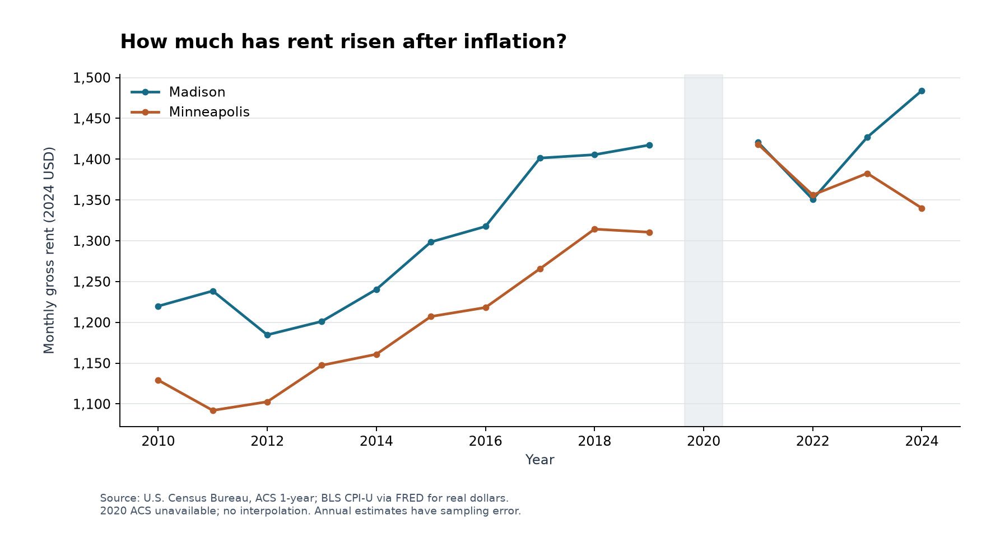
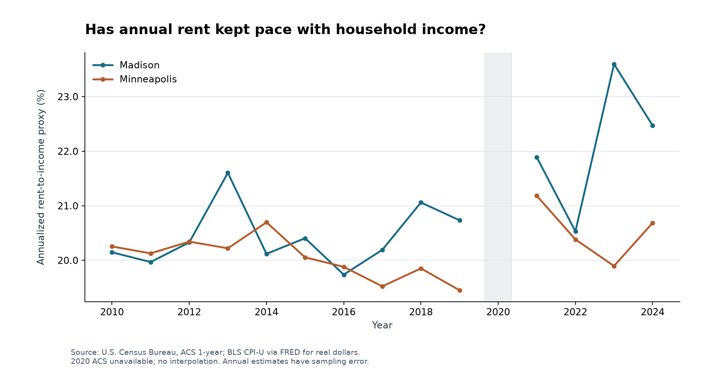
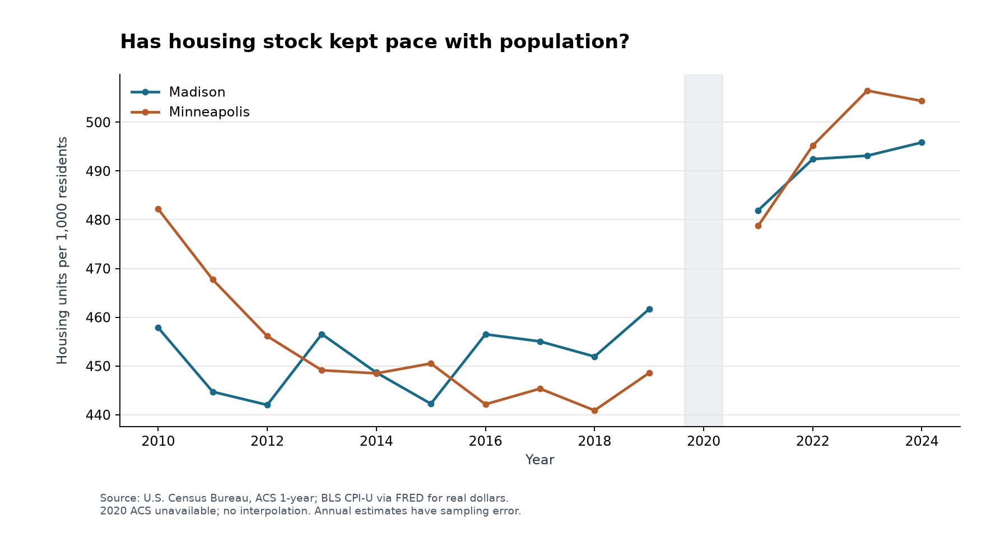

# MarketLens

MarketLens compares housing affordability in Madison and Minneapolis using Census ACS data and national CPI and mortgage-rate series from FRED. It includes a Python analysis pipeline, Streamlit app, Excel workbook, R cross-checks, and research report.

**Start here:** [Research report](report/report.md) · [HTML report](report/report.html) · [Excel workbook](excel/MarketLens_Analysis.xlsx) · [Methodology](docs/METHODOLOGY.md)

The study covers citywide housing conditions. Student wages, bedroom counts, and roommate budgets are outside its current scope.

## Research question

How has housing affordability changed in the two cities, and which economic conditions are associated with those changes? The question matters because rising housing costs can reduce resources available for other consumption and saving even when household incomes grow.

## Key findings

<!-- findings:start -->
- Madison: real median income changed 9.1%, real median rent 21.7%, and real median home value 33.3% from 2010 to 2024.
- Madison's annualized rent-to-income proxy changed from 20.15% to 22.47%; its home-value-to-income ratio changed from 4.32 to 5.28.
- Madison's direct renter cost-burden share changed from 56.7% to 51.2% among cash-rent units with computable ratios.
- Minneapolis: real median income changed 16.2%, real median rent 18.7%, and real median home value 16.6% from 2010 to 2024.
- Minneapolis's annualized rent-to-income proxy changed from 20.25% to 20.69%; its home-value-to-income ratio changed from 4.72 to 4.74.
- Minneapolis's direct renter cost-burden share changed from 52.9% to 46.6% among cash-rent units with computable ratios.
<!-- findings:end -->

Endpoint changes are descriptive point estimates, not significance tests. See the [research report](report/report.md) or [HTML report](report/report.html) for direct renter burden, supply trends, model results and limitations.

## Data sources

ACS 1-year detailed tables B01003, B19013, B25064, B25077, B25001, B25002, B23025 and B25070. Observed years: **2010–2019 and 2021–2024**. The CSV contains 30 city-year rows, including two missing 2020 rows; 28 city-years have ACS observations. Labor-force data begin in 2011. National CPIAUCSL (BLS) and MORTGAGE30US (Freddie Mac) are distributed by FRED and averaged annually over 2010–2024.

All raw downloads and metadata are preserved under `data/raw/`. Census files require no key. See [source documentation](docs/DATA_SOURCES.md), [variable dictionary](docs/DATA_DICTIONARY.md) and the [request manifest](data/processed/source_manifest.csv).

## Methods

Use 2024 constant dollars, ratios with explicit populations, adjacent-year growth, city-level summary statistics, level/change correlations and an exploratory OLS model with vacancy, a city indicator and a linear time trend. HC3 standard errors address heteroskedasticity, not serial dependence or survey uncertainty. See [methodology](docs/METHODOLOGY.md).

## Visualizations





All figures have units and sources. Lines break across the missing ACS year. The R chart is an independent reproduction, additional to the twelve Python figures.

## Interactive app

From the repository root in the activated environment:

```powershell
streamlit run app.py
```

Use city and year filters and the nominal/real selector. Six tabs cover the overview, affordability, housing/population, economic context, statistics and methods. Statistical tables use the full study period and are labeled accordingly. Download the CSV and workbook from the overview.

## Excel workbook

Open [excel/MarketLens_Analysis.xlsx](excel/MarketLens_Analysis.xlsx). The nine sheets include a dashboard with three charts, a filterable complete data table, city trends, visible affordability and inflation formulas, descriptive statistics, HC3 model results, sources and a dictionary. Percent values use 20 for 20%; growth rates can be negative and ratios can exceed 100%. Blank 2020 values are intentional. Formula results are cached for readers without Excel and recalculated by Excel on opening. Data edits update directly linked formulas; regenerate the pipeline to update Python statistics and narrative. The workbook is an analysis of historical data, not an interactive forecasting model.

## R validation

<!-- r-status:start -->
Latest R validation: **passed**.
<!-- r-status:end -->

Base R independently checks the proxy, inflation conversion, OLS coefficients and HC3 standard errors against Python and produces `figures/r_validation_proxy.png`. No R packages are required. The pipeline locates Rscript on PATH or in the usual Windows Program Files R installation. If unavailable, it records that the script was not run. Detailed execution evidence: [r_validation.json](data/results/r_validation.json).

## Repository structure

```text
app.py                 Streamlit application
src/                   Acquisition, cleaning, metrics, analysis, export and pipeline
data/raw/              Immutable official responses and checksum sidecars
data/processed/        City-year CSV, metadata, dictionary and request manifest
data/results/          Descriptive, correlation, model and validation outputs
figures/               Twelve Python charts and independent R chart
excel/                 Standalone analytical workbook
R/                     Independent validation script
report/                Markdown and HTML research report
docs/                  Sources, methodology, dictionary and acceptance audit
tests/                 Unit, data-integrity, output and application checks
scripts/               Source diagnostics and validation helpers
```

## Reproducing the analysis

Use Python 3.13 for the tested setup (the locked dependencies require Python 3.12 or newer). Run all commands from the repository root. A normal run reuses preserved raw downloads. The exact tested dependency versions are in `requirements-lock.txt`; `requirements.txt` permits compatible updates.

```powershell
python -m venv .venv
.venv\Scripts\Activate.ps1
python -m pip install -r requirements-lock.txt
python -m src.pipeline --offline
python -m pytest -q --junitxml=data/results/pytest.xml
python -m src.smoke_test
python -m src.audit
streamlit run app.py
```

If PowerShell activation is restricted, replace `python` with `.venv\Scripts\python.exe` and launch with `.venv\Scripts\python.exe -m streamlit run app.py`. On macOS/Linux activate with `source .venv/bin/activate`.

To download any missing official files, allow network access and run:

```powershell
python -m src.pipeline
```

For a new study vintage, preserve/rename the entire existing `data/raw` directory first, then run online. Latest-year discovery is cached with the original snapshot to keep ordinary reruns stable. A changed release requires reviewing definitions, interpretation, and the snapshot-specific tests before publication. Never manually overwrite raw observations. Offline reproduction fails clearly if any source file or checksum is missing.

To run R separately when Rscript is on PATH:

```powershell
Rscript R/validation_analysis.R
```

The complete validation record and SPEC checklist are in [VALIDATION.md](docs/VALIDATION.md) and [ACCEPTANCE.md](docs/ACCEPTANCE.md).

The publication copy was independently rebuilt and checked after packaging; see [packaging verification](docs/PACKAGING.md). The pipeline updates only the marked findings and R-status blocks in this README. Edit report text in `src/documentation.py`; the Markdown and HTML reports and source/methodology documents are rebuilt from it. Check the report interpretation and this README when changing the study period.

## Limitations

Annual ACS estimates have sampling error. Medians refer to different populations; the annualized rent-to-income proxy is not actual household rent burden. Direct burden excludes uncomputable ratios. Housing vacancy is not rental vacancy. Income and housing composition, boundaries and population controls can change. National CPI and mortgage rates are context, not local household measures. There is no 2020 interpolation, no 2010 B23025 labor-force estimate, no construction-flow series, and no causal identification.

## Disclaimer

This is descriptive and exploratory research for a student portfolio. It is not peer-reviewed work or personalized housing/financial advice. No faculty supervision or publication is claimed.
