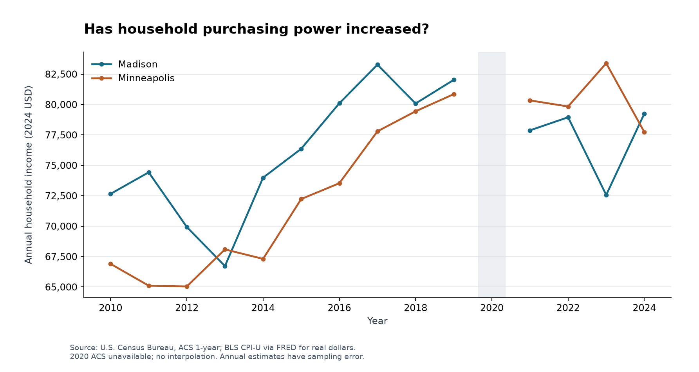
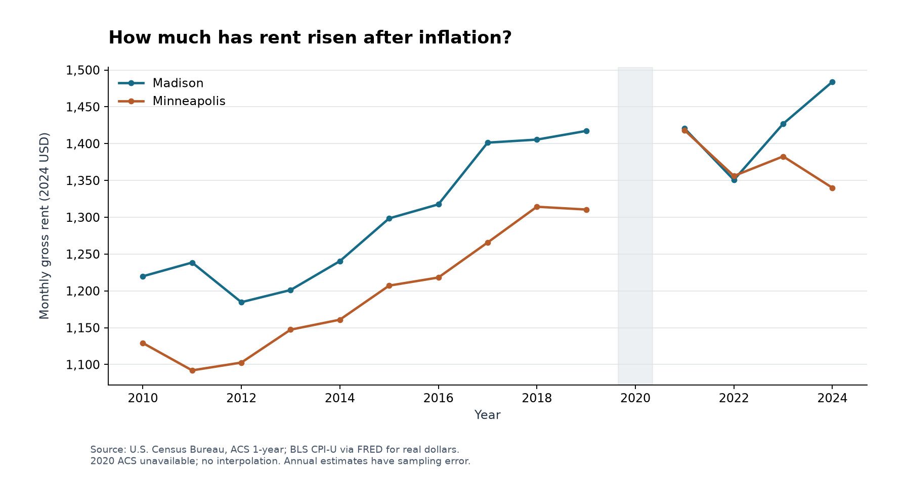
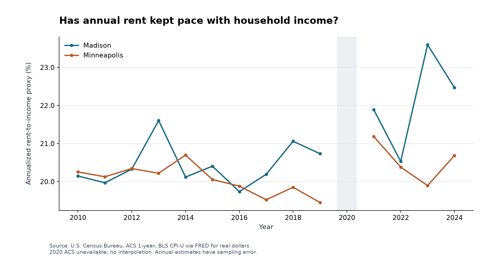
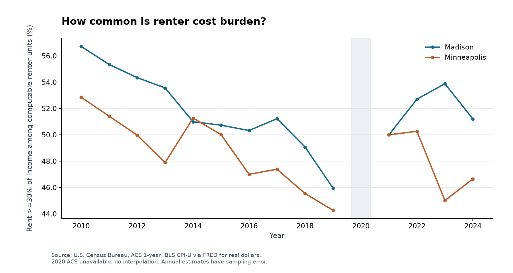
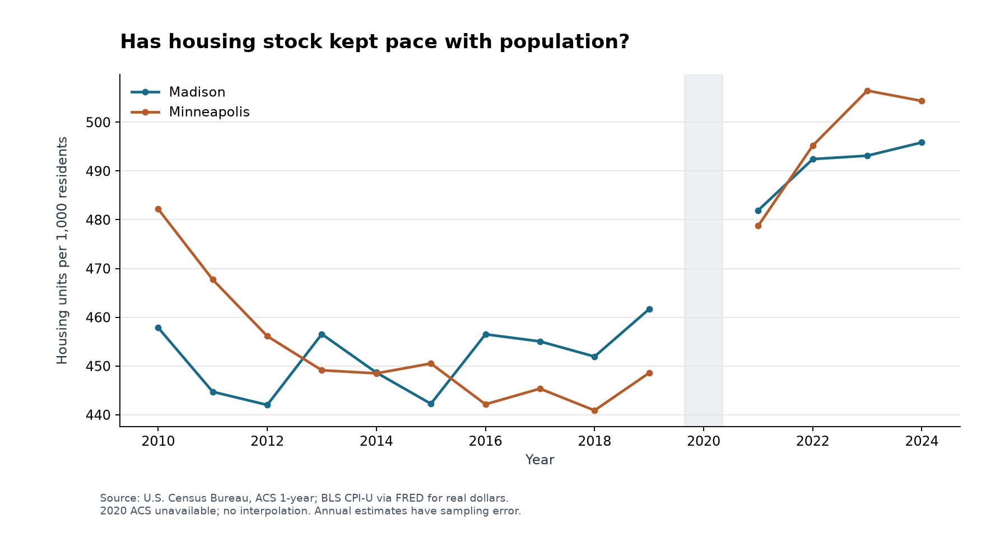

# MarketLens
## Housing affordability in Madison and Minneapolis, 2010–2024

### Abstract / Executive summary

This study asks how housing affordability changed in two Upper Midwest cities and which observed economic conditions moved with those changes. It combines U.S. Census Bureau American Community Survey 1-year estimates with national consumer prices and mortgage rates distributed by FRED. The analysis contains 14 observed years for each city; 2020 is an explicit gap. Dollar values are compared in nominal terms and in 2024 purchasing power. The evidence distinguishes a city-median affordability proxy from a direct distributional measure of renter cost burden.

Madison: real median income changed 9.1%, real median rent 21.7%, and real median home value 33.3% from 2010 to 2024. Madison's annualized rent-to-income proxy changed from 20.15% to 22.47%; its home-value-to-income ratio changed from 4.32 to 5.28. Madison's direct renter cost-burden share changed from 56.7% to 51.2% among cash-rent units with computable ratios. Minneapolis: real median income changed 16.2%, real median rent 18.7%, and real median home value 16.6% from 2010 to 2024. Minneapolis's annualized rent-to-income proxy changed from 20.25% to 20.69%; its home-value-to-income ratio changed from 4.72 to 4.74. Minneapolis's direct renter cost-burden share changed from 52.9% to 46.6% among cash-rent units with computable ratios. These are endpoint comparisons of annual point estimates, not tests of statistical significance. A small exploratory regression describes the association between vacancy and the rent-to-income proxy after city and trend controls. It does not identify the effect of additional housing or of any policy. 

### Research question

How has housing affordability changed in Madison and Minneapolis, and what economic factors are associated with those changes? The secondary questions distinguish three channels: housing costs relative to income, changes in the housing stock relative to population, and national financing conditions. A city can experience rising real incomes and still become less affordable under a cost-to-income measure if housing costs rise faster. Conversely, a larger housing stock does not guarantee that its location, quality or prices match the needs of lower-income households.

### Motivation

Housing absorbs resources that could otherwise finance consumption, saving or education. Renters face a recurring expense, while prospective homeowners face both an asset purchase and financing constraints. These are different economic decisions. A single price chart cannot capture them. Comparing rent and income growth asks whether the broad earnings environment kept pace with the cost of occupying rental housing. Comparing home values with income asks how large the housing asset is relative to household resources, while mortgage rates provide context for financing that asset.

Madison and Minneapolis offer a manageable city-level comparison. They are not a treatment and control group. Their household composition, housing mix, local institutions and surrounding metropolitan markets differ. City boundaries also do not enclose every job or housing alternative available to residents. The comparison is useful for describing distinct experiences and motivating further research, rather than evaluating one city's policy by treating the other as a counterfactual.

### Data

The core source is ACS 1-year detailed tables B01003, B19013, B25064, B25077, B25001, B25002, B23025 and B25070. Whole-city geography is identified from official files: Madison is state 55/place 48000; Minneapolis is state 27/place 43000. The observed years are 2010–2019 and 2021–2024. The cached release selection identifies 2024 as the latest complete table set found when the sources were downloaded. The 2010 B23025 labor-force fields are absent and left missing.

Population and housing counts are ACS estimates, not decennial Census enumerations. Income is median annual household income, gross rent is median monthly rent including the Census gross-rent concept, and home value is the median reported value of owner-occupied units. Those three monetary medians do not describe an identical household population. Original 90% margins of error are preserved alongside estimates. The current analysis uses point estimates and does not propagate survey uncertainty through derived statistics.

National CPI-U, all items, seasonally adjusted (CPIAUCSL) supplies the inflation adjustment. Freddie Mac's weekly 30-year fixed mortgage rate (MORTGAGE30US) supplies national financing context. CPI is averaged over all 12 months. Mortgage rates are averaged over all weekly observations dated in the calendar year, including holiday shifts. The PMMS methodology changed in November 2022, which limits a strict interpretation of small changes around that date.

### Methodology

All downloads are stored separately from processed data with their URL, retrieval timestamp and SHA-256 checksum. Census variable labels are checked for every year, and historical sequence-file columns are located using each release's official lookup. City geography is checked annually rather than inferred from a metropolitan label. Accounting checks reconcile occupied and vacant units to total units and employed and unemployed residents to the civilian labor force.

Real dollars equal nominal dollars multiplied by CPI in 2024 divided by CPI in the observation year. This removes broad national price inflation, but it does not measure the difference in living costs between these cities. Inflation cancels out of same-year ratios when both numerator and denominator are adjusted by the same index. The annualized rent-to-income proxy equals 12 times monthly median gross rent divided by annual median household income, expressed as a percentage. The home-value-to-income ratio divides the housing asset median by annual household income.

Direct renter burden uses B25070's categories: the count with gross rent at least 30% of income, divided by the total less ratios not computed. It is conditional on a computable ratio among renter-occupied units paying cash rent. Excluded households can differ systematically, so the dataset also reports the excluded share. Vacancy here means all vacant units divided by all housing units, not rental vacancy. Housing units per 1,000 residents is a stock-availability indicator, not a direct measure of units affordable to particular income groups.

Changes are computed only for adjacent observed calendar years. Standard ACS 1-year estimates were not released in 2020, and experimental estimates are not substituted. No graph interpolates the gap. Consequently, 2021 year-over-year growth is also unavailable. Endpoint changes compare 2010 with 2024 and are not annual growth rates. The statistical analysis separates levels from annual changes because trending series can correlate even without a stable economic relationship.

### Results

#### Nominal growth versus purchasing power

| City        | Measure                         |      2010 |      2024 |   Change (%) |
|:------------|:--------------------------------|----------:|----------:|-------------:|
| Madison     | median household income nominal |  50,508.0 |  79,254.0 |         56.9 |
| Madison     | median gross rent nominal       |     848.0 |   1,484.0 |         75.0 |
| Madison     | median home value nominal       | 218,200.0 | 418,400.0 |         91.8 |
| Madison     | median household income real    |  72,654.7 |  79,254.0 |          9.1 |
| Madison     | median gross rent real          |   1,219.8 |   1,484.0 |         21.7 |
| Madison     | median home value real          | 313,876.3 | 418,400.0 |         33.3 |
| Minneapolis | median household income nominal |  46,508.0 |  77,732.0 |         67.1 |
| Minneapolis | median gross rent nominal       |     785.0 |   1,340.0 |         70.7 |
| Minneapolis | median home value nominal       | 219,600.0 | 368,300.0 |         67.7 |
| Minneapolis | median household income real    |  66,900.8 |  77,732.0 |         16.2 |
| Minneapolis | median gross rent real          |   1,129.2 |   1,340.0 |         18.7 |
| Minneapolis | median home value real          | 315,890.2 | 368,300.0 |         16.6 |

The nominal series answer how many dollars are reported in each year. The real series answer how much those dollars represent relative to a common national purchasing-power benchmark. Their difference matters when evaluating whether higher reported income represents greater household resources. These are changes in city medians, not average gains for residents who remained in the city. Migration, changes in household size, shifts in tenure and changes in the mix of available housing can all move medians.

### Madison

The annualized rent-to-income proxy changed from 20.15% in 2010 to 22.47% in 2024, a change of 2.32 percentage points. This compares the rent charged for the median cash-rent unit with income for the median household across all tenures. A rise means rents outpaced this broad income benchmark; a fall means the reverse. Neither tracks the same renters or their budgets.

The home-value-to-income ratio moved from 4.32 to 5.28. The endpoint change in real home value was 33.3%, compared with 9.1% for real household income. Owner valuations and income therefore tell a different part of the affordability story from monthly rent. Existing owners can gain housing wealth while prospective buyers confront higher entry prices.

Population changed 22.0% and housing units changed 32.2%. Housing units per 1,000 residents changed from 457.9 to 495.9. These stock measures are consistent with housing availability changing relative to population, but they do not isolate construction, demolitions, conversions or boundary changes. Household size and the group-quarters population also affect the ratio.

The all-housing vacancy rate changed from 5.73% to 5.59%. This measure includes units held vacant for several reasons, so a higher value need not imply more rental listings available to a household searching today. Direct renter cost burden was 56.7% in 2010 and 51.2% in 2024 among units with a computable rent/income ratio. That statistic concerns the distribution of actual renter ratios and should not be inferred from the city-median proxy.
### Minneapolis

The annualized rent-to-income proxy changed from 20.25% in 2010 to 20.69% in 2024, a change of 0.43 percentage points. This compares the rent charged for the median cash-rent unit with income for the median household across all tenures. A rise means rents outpaced this broad income benchmark; a fall means the reverse. Neither tracks the same renters or their budgets.

The home-value-to-income ratio moved from 4.72 to 4.74. The endpoint change in real home value was 16.6%, compared with 16.2% for real household income. Owner valuations and income therefore tell a different part of the affordability story from monthly rent. Existing owners can gain housing wealth while prospective buyers confront higher entry prices.

Population changed 11.8% and housing units changed 17.0%. Housing units per 1,000 residents changed from 482.2 to 504.4. These stock measures are consistent with housing availability changing relative to population, but they do not isolate construction, demolitions, conversions or boundary changes. Household size and the group-quarters population also affect the ratio.

The all-housing vacancy rate changed from 10.29% to 10.03%. This measure includes units held vacant for several reasons, so a higher value need not imply more rental listings available to a household searching today. Direct renter cost burden was 52.9% in 2010 and 46.6% in 2024 among units with a computable rent/income ratio. That statistic concerns the distribution of actual renter ratios and should not be inferred from the city-median proxy.

#### Supply and financing context

Housing supply can ease price pressure in an economic model when other conditions are held fixed. The observed housing-stock-to-population ratio does not hold other conditions fixed. Developers can respond to strong demand at the same time that prices rise. The mix of new units, occupancy, household formation and income composition can also change. The supply scatterplot therefore supports a descriptive question about co-movement, not an estimate of a supply elasticity or of the effect of construction on rents.

The national mortgage average was 4.69% in 2010, 2.96% in 2021, and 6.72% in 2024. A higher rate can raise the payment required to finance an otherwise identical purchase. This study does not construct a representative mortgage payment because down payments, taxes, insurance, credit quality and existing fixed-rate loans are not observed. A home-value-to-income ratio can therefore remain similar while conditions for a new financed purchase change materially.

### Statistical analysis

Descriptive tables report separate city distributions, counts, variability and endpoint changes. Full correlation tables distinguish pooled observations from city-specific relationships and levels from annual changes. The selected vacancy relationship is shown below. A pooled coefficient combines cross-city differences with changes over time. Differencing reduces simple level trends but amplifies measurement noise and does not remove omitted-variable or reverse-causality problems. Ratios sharing household income can also correlate mechanically.

| scope       | form           |   n |   pearson_r |
|:------------|:---------------|----:|------------:|
| Pooled      | levels         |  28 |      -0.368 |
| Pooled      | annual_changes |  24 |      -0.325 |
| Madison     | levels         |  14 |      -0.492 |
| Madison     | annual_changes |  12 |      -0.583 |
| Minneapolis | levels         |  14 |       0.490 |
| Minneapolis | annual_changes |  12 |       0.495 |

The primary model regresses the annualized rent-to-income proxy on the all-housing vacancy rate, an indicator for Minneapolis and a common linear trend beginning in 2010. It uses 28 observations, 4 parameters and HC3 standard errors. R-squared is 0.352. Maximum non-intercept VIF is 2.59; the design is full rank. The small panel favors one housing-market covariate rather than a large collection of supply, unemployment, mortgage-rate and trend variables. Model choice is based on interpretability and data size, not statistical significance.

| term         |   coefficient |   robust_se |   p_value |   ci_95_low |   ci_95_high |
|:-------------|--------------:|------------:|----------:|------------:|-------------:|
| const        |       20.3800 |      0.8021 |    0.0000 |     18.7245 |      22.0354 |
| vacancy_rate |       -0.0130 |      0.1650 |    0.9378 |     -0.3535 |       0.3275 |
| minneapolis  |       -0.6931 |      0.4610 |    0.1458 |     -1.6446 |       0.2585 |
| time_trend   |        0.0872 |      0.0406 |    0.0421 |      0.0034 |       0.1711 |

The vacancy coefficient is -0.013 percentage points of the proxy per one percentage-point difference in vacancy, conditional on the city indicator and linear trend. Its HC3 standard error is 0.165, and its 95% conditional interval is [-0.353, 0.327]. These estimates describe an association within this specification. They are not the change in affordability caused by making additional units vacant.

The interval includes zero. The vacancy coefficient changes sign under the city-specific trend specification. These are conditional model results, not evidence of a causal effect.

Adding city-specific trends gives a vacancy coefficient of 0.022. Excluding one observed year at a time gives coefficients ranging from -0.087 to 0.108. These checks reveal dependence on trend assumptions and individual years. They are not independent replications. Residuals, leverage, Cook's distances, VIFs and the complete sensitivity table are saved with the model outputs for inspection.

Exploratory association, not a causal effect. ACS sampling error is not propagated. HC3 handles heteroskedasticity but not serial or shared-year dependence. Two cities are insufficient for reliable city-clustered inference. Common trends, omitted variables and endogenous vacancy limit interpretation. In particular, consecutive estimates for the same city and observations in a common national year need not be independent. HC3 does not correct those forms of dependence. With only two cities, cluster-based inference is not reliable. The reported confidence intervals and p-values should be treated as conditional exploratory summaries rather than decisive hypothesis tests.

### Limitations

The strongest limitation is measurement alignment. Rent concerns cash-rent units, home values concern owner-occupied units and income concerns all households. Their medians are not matched observations. The median-based proxy can move differently from renter burden because the income distribution, tenure composition and joint distribution of rent and income change. None of these measures reveals which individual households were displaced, became owners or experienced financial distress.

Sampling uncertainty is another constraint. The project retains the Census margins of error but does not have the covariance information needed for a full treatment of derived ratios and longitudinal comparisons. Small annual changes should not be interpreted as precise economic shifts. Population-control updates and city boundary changes can also affect estimates. The 2020 gap prevents a direct annual account of the pandemic transition, and the absence of 2010 labor-force data shortens that context series.

The analysis also omits local housing quality, unit size, neighborhood access, taxes, transportation costs, wealth, credit constraints and commuting across municipal boundaries. National CPI is not a local price index, and a national mortgage average is not the rate offered to a particular borrower. Housing-unit counts do not describe construction flows or affordable-unit availability. No building-permit series is included. 

### Conclusion

The evidence shows why housing affordability should be examined through several measures. Real incomes and real housing costs can rise together, while their relative pace determines the median-based ratios. The direct renter burden measure adds distributional information that those ratios cannot supply. Housing availability and national mortgage rates help frame the economic setting, but this two-city annual panel cannot separate competing causal mechanisms.

A defensible extension would add more comparable cities, explicit housing-quality and tenure controls, and a research design tied to a clearly defined policy or supply shock. It would also incorporate survey uncertainty and distinguish new borrowers from existing owners. The current results support a descriptive portfolio study and motivate those questions; they do not establish that a specific policy improved or worsened affordability.

### Reproducibility and validation

Python produces the processed dataset, statistics, figures, formula-bearing Excel workbook and this report. Numerical prose is generated from the saved analytical results, with headline claims recorded in JSON. Unit and integration tests check formulas, accounting identities, missing years, raw checksums, Excel formulas and cached results, output files and application behavior. The final execution record is in [VALIDATION.md](../docs/VALIDATION.md).

R validation status: **passed**. The R script independently recomputes the rent proxy, real income, OLS coefficients and HC3 standard errors and generates a separate chart. Its actual output is recorded in `data/results/r_validation.json`.

### Data sources

- [U.S. Census Bureau ACS summary files](https://www2.census.gov/programs-surveys/acs/summary_file/), ACS 1-year detailed tables, 2010–2019 and 2021–2024.
- [Census explanation of 2020 experimental data](https://www.census.gov/programs-surveys/acs/data/experimental-data.html).
- [BLS CPIAUCSL via FRED](https://fred.stlouisfed.org/series/CPIAUCSL), monthly observations, 2010–2024.
- [Freddie Mac MORTGAGE30US via FRED](https://fred.stlouisfed.org/series/MORTGAGE30US), weekly observations, 2010–2024.

Exact endpoints, retrieval dates, definitions and limitations appear in [DATA_SOURCES.md](../docs/DATA_SOURCES.md). This is a descriptive and exploratory student portfolio study; no peer review, causal identification or external supervision is claimed.
